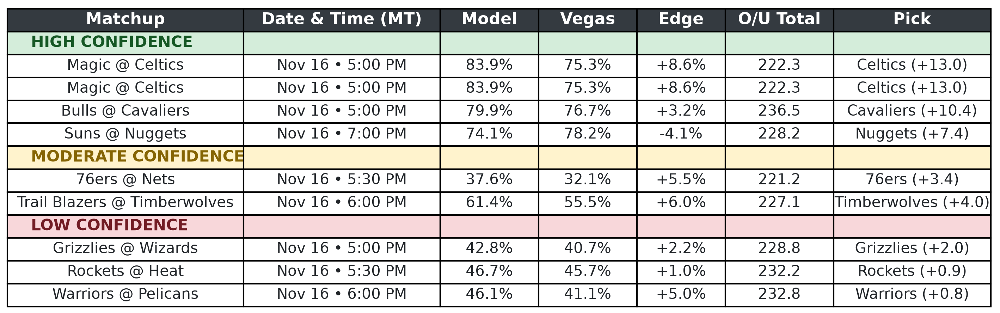

# NBA Predictive Engine 🏀

Welcome to the **NBA Predictive Engine**, a data-driven modeling tool designed to project straight-up winners, point spreads, and over/under totals for daily NBA matchups.

## 🚀 Getting Started

Follow these steps to set up the engine and generate your own daily predictions.

### Prerequisites

Ensure you have Python 3.8+ installed. It is recommended to use a virtual environment.

### Installation

1. Clone the repository:

   ```bash
   git clone https://github.com/yourusername/nba-predictive-engine.git
   cd nba-predictive-engine
   ```

2. Install the required dependencies:

   ```bash
   pip install -r requirements.txt
   ```

### Usage

To generate predictions for a specific date, run the main prediction script:

```bash
python predict.py --date 2026-11-16
```

*Note: Predictions and generated charts are saved to the `predictions/` directory.*

## 🎯 Today's Picks

Here are the model's projections for the current slate:



## 📈 Recent Performance Evaluation (Nov 15, 2026)

The model recently achieved a perfect **9–0 (100%)** record on straight-up winner picks across the entire November 15 NBA slate. Every predicted margin was also cleared by the winning team.

### Performance Breakdown

* **Straight-Up Winner Record:** 9–0 (100%)
  * **High Confidence:** 4–0 (100%)
  * **Moderate Confidence:** 1–0 (100%)
  * **Low Confidence:** 4–0 (100%)
* **Predicted Margin Clearance:** 9–0 (100%) — Every winner beat the model's projected victory margin (e.g., Celtics predicted by +7.7 won by +37).
* **Over/Under Totals:** 6 Overs, 3 Unders — Offensive pace exceeded model totals in two-thirds of the games.

### Game-by-Game Evaluation

| Matchup | Confidence | Model Pick (Margin) | Actual Result (Margin) | Winner | Proj. Total vs. Actual | 
| ----- | ----- | ----- | ----- | ----- | ----- | 
| **Spurs @ Jazz** | High | Spurs (+6.8) | Spurs 110–102 (+8) | ✅ | 228.9 vs. **212** (-16.9) | 
| **Mavericks @ Celtics** | High | Celtics (+7.7) | Celtics 131–94 (+37) | ✅ | 228.4 vs. **225** (-3.4) | 
| **Rockets @ Wizards** | High | Rockets (+8.2) | Rockets 147–119 (+28) | ✅ | 222.5 vs. **266** (+43.5) | 
| **Thunder @ Kings** | High | Thunder (+6.6) | Thunder 125–103 (+22) | ✅ | 231.6 vs. **228** (-3.6) | 
| **Pacers @ 76ers** | Moderate | 76ers (+2.6) | 76ers 131–124 (+7) | ✅ | 221.3 vs. **255** (+33.7) | 
| **Lakers @ Suns** | Low | Lakers (+1.1) | Lakers 131–123 (+8) | ✅ | 227.7 vs. **254** (+26.3) | 
| **Hornets @ Clippers** | Low | Clippers (+3.5) | Clippers 113–105 (+8) | ✅ | 216.5 vs. **218** (+1.5) | 
| **Knicks @ Raptors** | Low | Knicks (+2.7) | Knicks 112–108 (+4, OT) | ✅ | 223.9 vs. **220** (-3.9) | 
| **Hawks @ Bucks** | Low | Hawks (+0.4) | Hawks 113–106 (+7) | ✅ | 234.3 vs. **219** (-15.3) | 

### Key Takeaways

* **Massive Edge Validation:** The two largest positive edges on the board—**Hawks (+16.0% edge)** and **Spurs (+15.8% edge)**—both cashed cleanly on the road despite Vegas heavily favoring the Bucks and Jazz.
* **Conservative Margin Calibration:** While directional accuracy was flawless, the model underestimated blowout potential in the High Confidence tier (Celtics, Rockets, and Thunder won by an average of 29.0 points vs. a projected average of 7.5 points).