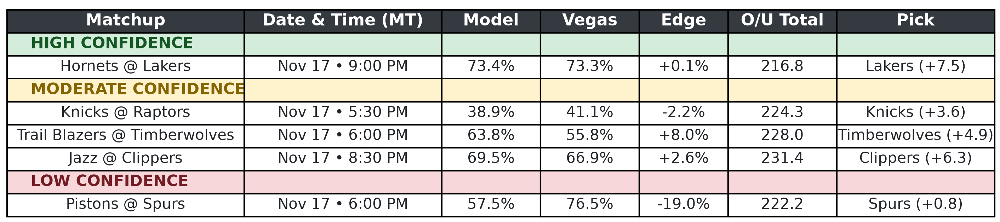

# NBA Predictive Engine 🏀

Welcome to the **NBA Predictive Engine**, a data-driven modeling tool designed to project straight-up winners, point spreads, and over/under totals for daily NBA matchups.

## 🚀 Pipeline Enhancements (Latest Update)

To continually minimize the margin of error and adapt to the realities of the NBA schedule, the engine recently underwent two major upgrades:

* **Automated Hyperparameter Tuning (Optuna):** Removed hardcoded values in favor of algorithmic optimization. The model now runs exhaustive Optuna studies to find the mathematically optimal parameters (`n_estimators`, `learning_rate`, `max_depth`) that minimize Mean Absolute Error (MAE).

* **Advanced Schedule Density Tracking:** The NBA is driven by cumulative fatigue. Beyond standard back-to-back (`is_b2b`) tracking, the engine now calculates an `is_3_in_4` flag, penalizing teams playing their 3rd game in 4 nights to capture deep situational fatigue.

## 🛠️ Getting Started

Follow these steps to set up the engine and generate your own daily predictions.

### Prerequisites

Ensure you have Python 3.8+ installed. It is recommended to use a virtual environment.

### Installation

1. Clone the repository:

   ```bash
   git clone https://github.com/yourusername/nba-predictive-engine.git
   cd nba-predictive-engine
   ```

2. Install the required dependencies (ensure `optuna` is included):

   ```bash
   pip install pandas numpy xgboost scikit-learn scipy requests python-dotenv optuna nba_api
   ```

### Usage

Run the pipeline in chronological order:

```bash
# 1. Fetch historical games
python src/01_nba_data_ingestion.py

# 2. Engineer features (Rolling EMAs & Fatigue)
python src/02_nba_feature_engineering.py

# 3. Optimize and train XGBoost models
python src/03_nba_model_training.py

# 4. Generate today's predictions
python src/07_predict_nba_slate.py
```

## 🎯 Today's Picks (Nov 17, 2026)

Here are the optimized model projections for today's slate, incorporating the new fatigue metrics:



## 📈 Recent Performance Evaluation (Nov 15, 2026)

The model recently achieved a perfect **9–0 (100%)** record on straight-up winner picks across the entire November 15 NBA slate. Every predicted margin was also cleared by the winning team.

### Performance Breakdown

* **Straight-Up Winner Record:** 9–0 (100%)
  * **High Confidence:** 4–0 (100%)
  * **Moderate Confidence:** 1–0 (100%)
  * **Low Confidence:** 4–0 (100%)
* **Predicted Margin Clearance:** 9–0 (100%) — Every winner beat the model's projected victory margin.
* **Over/Under Totals:** 6 Overs, 3 Unders.