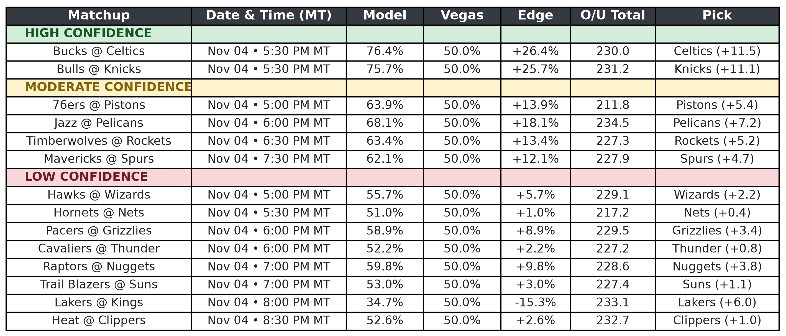

# 🏀 NBA Predictive Engine (`nba-predictive-engine`)

An end-to-end machine learning pipeline that forecasts NBA game outcomes, point margins, win probabilities, and over/under total points using **XGBoost Regressors**, **Four Factors efficiency metrics**, **season-isolated opponent adjustments**, and **time-shifted Exponential Moving Averages (EMA)**.

Built as the basketball counterpart to the NFL Predictive Engine, this system adapts heavy schedule variance, possession estimation, and rest-day fatigue dynamics into a production-ready predictive model.

---

## 📊 NBA Predictions 11-04-2026


---

## 🏗️ Repository Architecture

```text
nba-predictive-engine/
├── data/                                 # Raw game logs & engineered EMA feature matrices
├── models/                               # Serialized XGBoost Margin & Totals models (.joblib)
├── predictions/                          # Daily JSON slates (ISO-8601 UTC) & rendered MT PNG tables
├── src/
│   ├── 01_nba_data_ingestion.py          # Pulls NBA game logs via nba_api & computes Four Factors
│   ├── 02_nba_feature_engineering.py     # Season-isolated ratings, rolling momentum (Span=10), & rest/B2B
│   ├── 03_nba_model_training.py          # Trains dual XGBoost Regressors (Margin & Total Points)
│   ├── 07_predict_nba_slate.py           # Daily slate inference, Vegas 80/20 blend, & UTC export
│   └── render_nba_prediction_table.py    # Renders 7-column Mountain Time summary graphic
├── .env.example                          # Environment configuration template
├── .gitignore                            # Excludes venv/, cache, and local secrets
├── requirements.txt                      # Pinned Python 3.12+ package dependencies
└── README.md                             # Project documentation
```

---

## 📊 Feature Engineering & Methodology

1. **Possession & Four Factors Extraction (`01_nba_data_ingestion.py`)**
   - Estimates game possessions using Dean Oliver's standard formula:
     $$\text{Possessions} = \text{FGA} + 0.44 \times \text{FTA} - \text{OREB} + \text{TOV}$$
   - Computes **Pace**, **Offensive Rating** ($\text{OffRtg}$), **Defensive Rating** ($\text{DefRtg}$), **Net Rating** ($\text{NetRtg}$), **Effective Field Goal %** ($\text{eFG\%}$), **True Shooting %** ($\text{TS\%}$), **Turnover %** ($\text{TOV\%}$), and **Offensive Rebound %** ($\text{OREB\%}$).

2. **Leakage-Free EMAs & Season-Isolated Adjustments (`02_nba_feature_engineering.py`)**
   - Applies `.shift(1).ewm(span=10, adjust=False).mean()` chronologically per team so only pre-game data enters the feature vector.
   - Computes league average offensive ratings strictly **per season** (`season_avg`) to eliminate cross-season data leakage.
   - Incorporates rolling momentum metrics (`diff_win_pct`, `diff_game_margin`) alongside schedule fatigue indicators (`rest_days`, `rest_diff`, and binary Back-to-Back `is_b2b` flags).

3. **Dual XGBoost Regressors & Win Probability Calibration (`03_nba_model_training.py` & `07_predict_nba_slate.py`)**
   - Trains two optimized `XGBRegressor` models (`objective='reg:absoluteerror'`, `max_depth=4`, `n_estimators=350`).
   - Converts predicted margins into win probabilities via normal CDF ($\sigma = 12.0$) and blends **80% Model Probability + 20% Implied Vegas Probability**.
   - Groups predictions into **High**, **Moderate**, and **Low** confidence tiers based on edge magnitude and consensus.

---

## 🚀 Quickstart Guide

### 1. Clone & Set Up Virtual Environment (macOS / zsh)
```zsh
git clone https://github.com/cdinh92/nba-predictive-engine.git
cd nba-predictive-engine

python3.12 -m venv venv
source venv/bin/activate
pip install --upgrade pip
pip install -r requirements.txt
```

### 2. Run the Full Predictive Pipeline
```zsh
# Step 1: Ingest historical & active NBA game logs via nba_api
python src/01_nba_data_ingestion.py

# Step 2: Engineer season-isolated adjustments, rolling momentum, and rest features
python src/02_nba_feature_engineering.py

# Step 3: Train and serialize XGBoost Margin & Total Points models (.joblib)
python src/03_nba_model_training.py

# Step 4: Run daily slate predictions (exports UTC JSON payload)
python src/07_predict_nba_slate.py

# Step 5: Render 7-column Mountain Time prediction graphic
python src/render_nba_prediction_table.py
```

---

## 🛠️ Tech Stack
* **Language:** Python 3.12+
* **Data Source:** `nba_api` (Stats Endpoints)
* **Machine Learning:** `XGBoost`, `Scikit-Learn`, `SciPy`
* **Data Processing:** `Pandas`, `NumPy`
* **Visualization:** `Matplotlib`