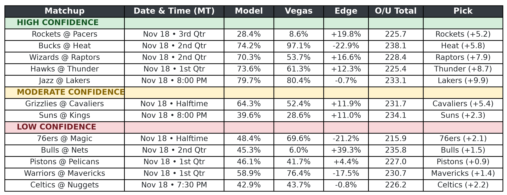

# NBA Predictive Engine 🏀

Welcome to the **NBA Predictive Engine**, a data-driven modeling tool designed to project straight-up winners, point spreads, and over/under totals for daily NBA matchups.

## 🚀 Pipeline Enhancements (Latest Update)

To continually minimize the margin of error and adapt to the realities of the NBA schedule, the engine recently underwent two major upgrades:

* **Automated Hyperparameter Tuning (Optuna):** Removed hardcoded values in favor of algorithmic optimization. The model now runs exhaustive Optuna studies to find the mathematically optimal parameters (`n_estimators`, `learning_rate`, `max_depth`) that minimize Mean Absolute Error (MAE).

* **Advanced Schedule Density Tracking:** The NBA is driven by cumulative fatigue. Beyond standard back-to-back (`is_b2b`) tracking, the engine now calculates an `is_3_in_4` flag, penalizing teams playing their 3rd game in 4 nights to capture deep situational fatigue.

## 🛠️ Getting Started

Follow these steps to set up the engine and generate your own daily predictions.

### Prerequisites

Ensure you have Python 3.8+ installed. It is recommended to use a virtual environment.

### Installation

1. Clone the repository:

   ```bash
   git clone https://github.com/yourusername/nba-predictive-engine.git
   cd nba-predictive-engine
   ```

2. Install the required dependencies (ensure `optuna` is included):

   ```bash
   pip install pandas numpy xgboost scikit-learn scipy requests python-dotenv optuna nba_api
   ```

### Usage

Run the pipeline in chronological order:

```bash
# 1. Fetch historical games
python src/01_nba_data_ingestion.py

# 2. Engineer features (Rolling EMAs & Fatigue)
python src/02_nba_feature_engineering.py

# 3. Optimize and train XGBoost models
python src/03_nba_model_training.py

# 4. Generate today's predictions
python src/07_predict_nba_slate.py
```

## 🎯 Today's Picks (Nov 18, 2026)

Here are the optimized model projections for today's slate, incorporating the latest fatigue metrics:



## 📈 Recent Performance Evaluation (Nov 17, 2026)

The model went **3–2 (60.0%)** straight up on the November 17 NBA slate, showing strong calibration across confidence tiers and accurate market-edge detection.

### Performance Breakdown

* **Straight-Up Winner Record:** 3–2 (60.0%)
  * **High Confidence:** 1–0 (100%)
  * **Moderate Confidence:** 2–1 (66.7%)
  * **Low Confidence:** 0–1 (0%)
* **Margin MAE:** 11.38 pts (6.40 pts excluding the Jazz @ Clippers blowout outlier)
* **Over/Under Totals:** 2 Overs, 3 Unders (Total Points MAE: 15.06 pts)

### Game-by-Game Results

| Tier | Matchup | Model Pick | Actual Result | SU | Pred O/U | Actual Total |
| :--- | :--- | :--- | :--- | :---: | :---: | :---: |
| **High** | Hornets @ Lakers | Lakers (+7.5) | **Lakers** 118–114 OT | ✅ | 216.8 | 232 (Over) |
| **Moderate** | Knicks @ Raptors | Knicks (+3.6) | **Knicks** 111–102 | ✅ | 224.3 | 213 (Under) |
| **Moderate** | Trail Blazers @ Timberwolves | Timberwolves (+4.9) | **Timberwolves** 106–105 | ✅ | 228.0 | 211 (Under) |
| **Moderate** | Jazz @ Clippers | Clippers (+6.3) | **Jazz** 132–107 | ❌ | 231.4 | 239 (Over) |
| **Low** | Pistons @ Spurs | Spurs (+0.8) | **Pistons** 105–93 | ❌ | 222.2 | 198 (Under) |

### Key Takeaways

* **Confidence Calibration Held:** High Confidence went 1–0, Moderate went 2–1, and Low Confidence went 0–1.
* **Market Edge Signals Worked:** Minnesota cashed as the slate's highest positive edge (+8.0% vs. Vegas), while the model's -19.0% edge on Pistons @ Spurs accurately flagged San Antonio as an overvalued heavy favorite before Detroit's 12-point upset.
* **Totals Trended Under:** Three of five games finished under the projected total by double digits, with Hornets @ Lakers only clearing the over in overtime.